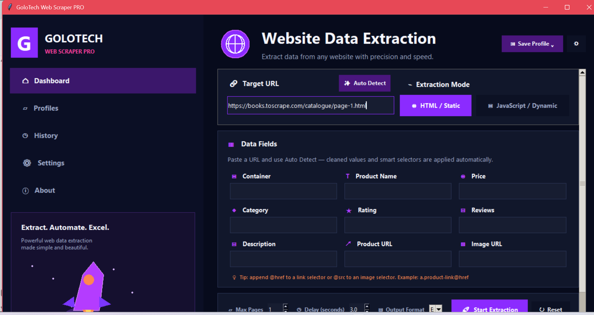
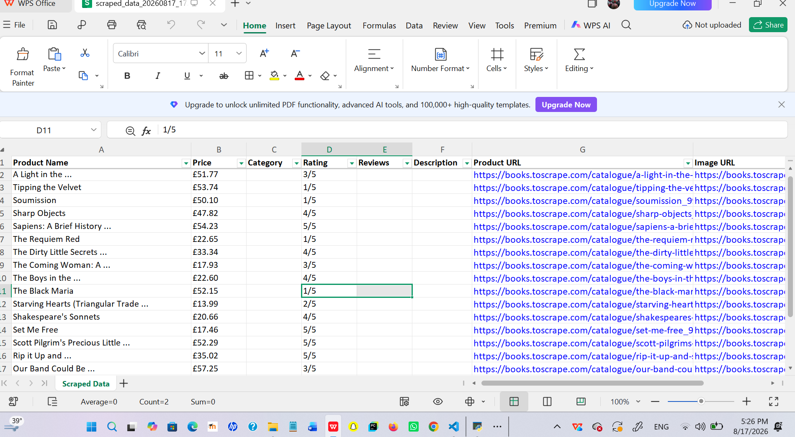

# GoloTech Web Scraper PRO

**Python Desktop Application | Web Scraping | Data Extraction**

GoloTech Web Scraper PRO is a Python-based desktop application designed to simplify the extraction of permitted public website data and organize results into structured formats.

## Key Features

- Desktop graphical user interface (GUI)
- Website URL input
- Structured data extraction
- Export to Excel, CSV, and JSON
- Data collection workflow designed to reduce repetitive manual tasks

## Technologies

- Python
- Web Scraping
- Desktop GUI Development
- Data Processing

## Screenshots

## Screenshots

### Application Interface

### Sample Extraction Results

*Demonstration using publicly available sample data from books.toscrape.com.*

## Project Status

Portfolio showcase. Source code is private.

## Availability

Available for freelance projects and custom Python automation solutions.

## Contact

**Developer:** Aisha Mohammad

**Brand:** GoloTech

**Email:** aisha.golotech@gmail.com

**LinkedIn:** See the link on my GitHub profile.

---

*This repository is intended for portfolio presentation. The application source code is not included.*
